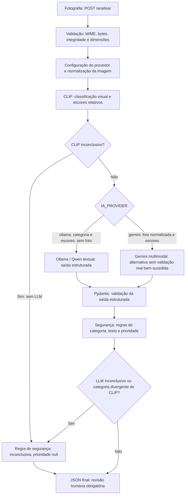

# Zela — Zeladoria Colaborativa com IA

Projeto IoT/IA para a Global Solution 2026/2 da FIAP. Este microsserviço apoia a
identificação de problemas urbanos em fotografias e sugere prioridades sujeitas
à revisão humana. Combina visão computacional real com CLIP e organização textual
com Qwen via Ollama local. Gemini foi preservado como alternativa multimodal;
suas chamadas reais de API ainda não foram validadas com sucesso.

## Arquitetura

Cliente → FastAPI → validação → CLIP zero-shot → provedor selecionado → validação
Pydantic → regras determinísticas de segurança → JSON. O padrão é Ollama local;
Gemini é uma opção independente, sem fallback automático entre provedores.
Quando CLIP abstém, a resposta inconclusiva é construída a partir dessa abstenção,
sem chamar qualquer LLM ou solicitar prioridade.



- `app/main.py`: aplicação, `/health`, `/analisar` e documentação OpenAPI.
- `app/config.py`: nome do serviço e limite de upload.
- `app/schemas/analise.py`: categorias, escores visuais e contratos JSON.
- `app/services/imagens.py`: MIME, bytes, dimensões e integridade.
- `app/services/visao.py`: CLIP, carga sob demanda e reutilização por processo.
- `app/services/generativa.py`: SDK oficial google-genai, prompt e validação.
- `app/services/ollama.py`: HTTP local via httpx, JSON Schema e validação rigorosa.
- `app/services/seguranca.py`: descrições permitidas, prioridades e abstenção.
- `app/services/analise.py`: normalização da foto e coordenação das etapas.
- `app/services/erros.py`: erros públicos sem detalhes internos.
- `tests/test_api.py`: validações HTTP originais.
- `tests/test_ia.py`, `tests/test_ollama.py` e `tests/conftest.py`: integração e falhas com stubs isolados.
- `scripts/avaliar_clip.py` e `tests/test_avaliar_clip.py`: avaliação por CSV e testes do avaliador.
- [data/avaliacao/](data/avaliacao/): manifesto e relatórios da avaliação real; fotos mantidas apenas localmente.
- [docs/avaliacao.md](docs/avaliacao.md): preparação das fotos, protocolo, resultados e limitações.
- [docs/evidencias/analise-buraco.json](docs/evidencias/analise-buraco.json): corpo da resposta real da API.

A API não armazena fotografias permanentemente. O framework pode usar arquivos
multipart temporários. Após validação, a foto tem orientação EXIF aplicada,
é convertida em RGB, reduzida a no máximo 1600 × 1600 mantendo a proporção e
reencodificada sem metadados quando o provedor é Gemini.
**O Qwen recebe exclusivamente a categoria CLIP, seus escores relativos e a
indicação de abstenção, junto das instruções de formatação e segurança. Não recebe
a fotografia, nome do arquivo, pixels, base64 ou localização.** Ele não consegue
confirmar objetos nem acrescentar observações visuais. Se `IA_PROVIDER=gemini`,
a imagem normalizada e os escores são enviados ao Google, preservando a integração
multimodal existente. Somente CLIP vê a fotografia no fluxo local com Qwen textual.

## Modelos e interpretação

O modelo `openai/clip-vit-base-patch32` é utilizado via Transformers e PyTorch em
CPU. Ele compara a imagem com estas descrições em inglês:

| Categoria retornada | Descrição candidata |
| --- | --- |
| `buraco_no_asfalto` | a photo of a pothole in an asphalt road |
| `entulho_ou_lixo` | a photo of garbage or construction debris dumped on a street |
| `calcada_danificada` | a photo of a broken or damaged sidewalk |
| `iluminacao_visivelmente_danificada` | a photo of a visibly broken street light fixture or damaged light pole |
| `sem_problema_evidente` | a photo of an urban street with no evident maintenance problem |

O softmax dos logits produz **escores relativos às candidatas**, não probabilidades
calibradas de um problema existir. Mudar as descrições muda os escores. CLIP sempre
compara essas cinco opções; não é um detector validado de todos os problemas urbanos.

Há abstenção conservadora se o maior escore for menor que 0,40 ou a diferença para
o segundo for menor que 0,10. São heurísticas iniciais, sem calibração em dados
locais. Também há abstenção se o provedor indicar incerteza ou discordar da categoria
mais bem pontuada pelo CLIP. A resposta usa `categoria=inconclusiva`,
`analise_inconclusiva=true`, `prioridade=null` e `revisao_humana=true`.
Uma descrição neutra substitui conclusões conflitantes nesses casos.

Ollama usa `POST /api/chat`, `stream=false`, `format` com o JSON Schema do
`AnaliseGerada`, `options.temperature=0` e limite de geração de 512 tokens.
O modelo padrão é `qwen2.5:1.5b`. A resposta deve terminar completamente e passar
pela validação Pydantic rigorosa: campos obrigatórios, enums, booleanos reais,
strings não vazias e rejeição de campos extras. JSON inválido não vira sucesso.

Gemini mantém o SDK oficial, imagem e JSON estruturado. Seu modelo padrão
configurável é `gemini-3.8-flash`. A disponibilidade depende da conta e do provedor.
Essa integração foi preservada como alternativa multimodal, mas chamadas reais de
sua API não foram validadas com sucesso; os testes com stubs não comprovam seu
funcionamento externo.
Ambos passam pela mesma política de saída segura descrita abaixo.

Todas as respostas exigem revisão humana nesta versão. A prioridade **não é decisão
oficial**. O contrato continua aceitando `baixa`, `media`, `alta` ou `null`, mas a
política desta versão emite somente `media` para triagem de categorias de problema
e `null` nos demais casos. Os nomes dos cinco campos originais foram preservados; `categoria` agora
é enumerada e `prioridade` admite `null` para evitar atribuições sem fundamento.

Uma fotografia não prova que uma luminária está apagada: a candidata de iluminação
trata apenas de danos físicos visíveis. O prompt proíbe inventar localização,
dimensões, risco confirmado ou pessoas envolvidas e manda ignorar instruções
escritas na imagem. Pydantic valida estrutura e tipos; não comprova a veracidade
das afirmações. Os modelos podem errar, inclusive em fotos fora do domínio ou com
baixa qualidade; a abstenção não garante detectar todos esses casos. A avaliação
exploratória com 3 fotografias reais teve 3 acertos, mas a amostra é pequena e
**não comprova acurácia geral** nem representa todas as categorias e condições.

## Contenção de alucinações e prioridade

Prompts, temperatura zero e JSON Schema não garantem veracidade. A API aplica uma
**lista fechada de descrições condicionais**, mantida em `app/services/seguranca.py`.
Por exemplo, para buraco: “Pode haver um buraco no asfalto; é necessária verificação
humana.” Somente a frase exata permitida para a categoria CLIP é aceita; qualquer
outra descrição é descartada e substituída pela frase genérica. Isso inclui textos
plausíveis que acrescentem uma TV, pessoas, medidas, endereço, causas ou riscos.
O descarte é indicado na justificativa, sem repetir o texto rejeitado. Não há uma
blacklist de palavras que possa deixar passar sinônimos ou invenções diferentes.

A justificativa também é construída por regras e nunca reproduz texto livre do
LLM. Essa restrição vale para Ollama e Gemini. A IA generativa participa de uma
resposta estruturada de confirmação/abstenção; as afirmações finais ficam limitadas
às categorias sugeridas pelo CLIP. A frase genérica é uma regra transparente de
segurança. A descrição padronizada final deve ser atribuída a essa camada, e não
apresentada como texto gerado pelo Qwen. A saída do Qwen pode copiar a frase
permitida pelo prompt; a API usa a frase definida em código e pode descartar uma
descrição livre diferente. Isso não acrescenta observações visuais ao CLIP.

| Situação | Prioridade emitida | Regra |
| --- | --- | --- |
| Buraco, lixo/entulho, calçada ou iluminação fisicamente danificada, sem abstenção | `media` | Sugestão neutra de triagem pela categoria, sem inferir severidade. |
| Sem problema evidente | `null` | Ausência de evidência não comprova ausência de problema. |
| CLIP inconclusivo, LLM inconclusivo ou categorias divergentes | `null` | Retornar análise inconclusiva e revisão humana obrigatória. |

Uma prioridade `alta` ou `baixa` enviada pelo LLM não altera a tabela. Uma prioridade
fora do enum invalida a resposta (502). As regras não usam o escore como chance de
acidente e não avaliam urgência real. Casos graves podem precisar de triagem humana
imediata; a API não realiza despacho nem toma decisões oficiais. Erros do CLIP
ainda podem resultar em uma categoria incorreta, mesmo com texto controlado.

## Requisitos e execução local

Python 3.10 ou superior, pip e recursos de memória/disco compatíveis com PyTorch e
CLIP. Não é necessária GPU. A instalação inclui bibliotecas grandes; execute-a
quando desejar preparar o ambiente:

```bash
python3 -m venv .venv
source .venv/bin/activate
python -m pip install -r requirements.txt
cp -n .env.example .env
```

As dependências Python permanecem as existentes: o serviço Ollama reutiliza httpx,
sem SDK adicional. No ambiente já preparado, basta ativar `.venv`.

Para o Ollama local já instalado, confirme que o servidor está em execução e que
`qwen2.5:1.5b` está presente (`ollama list`). Se precisar iniciar o servidor, execute
`ollama serve` em outro terminal. A aplicação não baixa nem instala modelos Ollama.
Em um Mac com 8 GB, comece com um único processo Uvicorn: CLIP e Qwen compartilham
os recursos locais e a primeira chamada pode incluir a carga dos modelos.

Edite `.env` com `IA_PROVIDER=ollama` (padrão), `OLLAMA_MODEL=qwen2.5:1.5b`,
`OLLAMA_BASE_URL=http://127.0.0.1:11434` e `OLLAMA_TIMEOUT_SECONDS=60`.
Para selecionar Gemini, use `IA_PROVIDER=gemini` e preencha `GEMINI_API_KEY` com
sua chave, além de um `GEMINI_MODEL` compatível. Ollama não exige essa chave.
Nunca versione chaves: `.env` permanece ignorado pelo Git.
O arquivo não é carregado automaticamente; em Bash/Zsh, exporte-o antes de iniciar:

```bash
set -a
source .env
set +a
python -m uvicorn app.main:app --reload --host 127.0.0.1 --port 8000
```

| Variável | Configuração |
| --- | --- |
| `IA_PROVIDER` | `ollama` (padrão) ou `gemini`; valor inválido retorna 503. |
| `OLLAMA_MODEL` | Padrão `qwen2.5:1.5b`; deve existir no servidor local. |
| `OLLAMA_BASE_URL` | Padrão `http://127.0.0.1:11434`; aceita apenas loopback (`127.0.0.1`, `localhost`, `::1`), sem credenciais, caminho ou query. |
| `OLLAMA_TIMEOUT_SECONDS` | Número positivo finito; padrão 60 segundos para operações HTTP. |
| `GEMINI_API_KEY` | Obrigatória somente para Gemini; sem valor no exemplo. |
| `GEMINI_MODEL` | Padrão `gemini-3.8-flash`; deve estar disponível para sua conta. |
| `MAX_IMAGE_SIZE_MB` | Inteiro positivo; padrão 5 MiB (5.242.880 bytes). |
| `HF_HOME` | Opcional; diretório de cache gerenciado pelo Hugging Face. |

CLIP só é carregado na primeira análise válida com configuração do provedor válida. Essa
requisição poderá baixar pesos/configurações do Hugging Face se não estiverem em
cache; poderá demorar e requerer internet. Importar a API, consultar `/health`,
gerar OpenAPI e coletar/executar os testes não baixa pesos. Depois da carga, o
modelo é reutilizado, com inferência serializada por processo. Cada worker teria
sua própria cópia; comece com um processo. Falhas de carga retornam 503 e permitem
nova tentativa numa próxima requisição. Não há fallback simulado.

Ollama usa o timeout configurado e uma tentativa, sem fallback para Gemini.
O cliente local ignora proxies do ambiente e não segue redirecionamentos. Gemini
mantém timeout HTTP de 30 segundos e uma tentativa. Esses tempos são limites de
operações HTTP, não um prazo total que inclua a inferência CLIP. Chamadas Gemini
estão sujeitas às cotas e condições da conta Google.

Swagger: http://127.0.0.1:8000/docs · ReDoc: http://127.0.0.1:8000/redoc

## Endpoints

`GET /health` retorna HTTP 200:

```json
{"status": "ok", "servico": "zela-analise-urbana"}
```

É uma checagem de execução da API, sem carregar modelos nem consultar o provedor.

`POST /analisar` recebe multipart/form-data no campo obrigatório `fotografia`:

```bash
curl -i http://127.0.0.1:8000/analisar -F 'fotografia=@/caminho/foto.jpg;type=image/jpeg'
```

Aceita JPEG, PNG e WebP com MIME compatível com o conteúdo real. Rejeita arquivos
vazios, falsos, corrompidos, acima do limite em bytes ou de 25 milhões de pixels.
O limite de bytes é aplicado depois do parsing multipart; em implantação, o gateway
também precisa limitar o corpo da requisição. Para arquivos animados, somente o
primeiro quadro é analisado.

| HTTP | Situação |
| --- | --- |
| 200 | Análise estruturada, que pode ser inconclusiva. |
| 400 | Conteúdo vazio, inválido ou corrompido. |
| 413 | Limite de bytes ou pixels excedido. |
| 415 | MIME não permitido ou divergente do formato real. |
| 422 | Campo ausente ou requisição incompatível. |
| 502 | Provedor retornou JSON/resposta incompleta ou inválida, ou Ollama rejeitou o schema. |
| 503 | Configuração inválida, falha do CLIP, Ollama desconectado/modelo ausente ou provedor indisponível. |
| 504 | Timeout do provedor selecionado. |

Erros retornam `{"detail": "mensagem pública"}`, sem chave nem exceções internas.
O contrato HTTP 200 está documentado em OpenAPI e contém `categoria`, `descricao`,
`prioridade`, `justificativa`, `revisao_humana`, `analise_inconclusiva`,
`visao_computacional` (modelo, cinco escores, indicação de abstenção e observação)
e `aviso` sobre prioridade sugerida. Os escores são ordenados do maior ao menor.

## Testes

```bash
source .venv/bin/activate
python -m pytest -q
```

Resultado verificado: **89 testes automatizados aprovados**.

Os testes usam imagens pequenas em memória e substituem dependências externas por
stubs: não precisam de chave, internet, Transformers, PyTorch nem SDK Google para
rodar com as dependências HTTP/Pillow/Pydantic de teste já instaladas. As fixtures
removem credenciais do ambiente e bloqueiam os pontos de chamada externa por padrão.
Stubs nunca participam da execução de produção.

Cobertura: validações HTTP, sucesso integrado, imagem/escores enviados ao Gemini,
somente categoria/escores enviados ao Ollama, seleção de provedor, modelo/timeout
configuráveis, ausência de chave Gemini, resposta malformada ou bloqueada,
modelo Ollama ausente, timeout/indisponibilidade sem vazamento, descarte de objeto
alucinado e justificativa livre, prioridade determinística, abstenção sem LLM, carga
CLIP sob demanda e reutilização, além de importação/OpenAPI sem bibliotecas pesadas.
São testes de comportamento com stubs, não uma validação de qualidade dos modelos
nem uma chamada real aos provedores.

## Declaração do uso de IA

O projeto usa CLIP para classificação visual zero-shot e um LLM selecionável para
organização estruturada: Qwen 2.5 1.5B via Ollama local ou Gemini via Google.
Qwen é textual neste fluxo e não inspeciona a foto. A implementação foi assistida
por um agente de programação com IA e verificada por testes automatizados com
dependências externas substituídas. Separadamente, foram realizadas a avaliação
exploratória do CLIP com fotos reais e uma requisição real à API com Ollama local,
descritas abaixo. Os testes com stubs verificam comportamento; as execuções reais
registram funcionamento nos casos observados, sem comprovar acurácia geral.
Gemini continua como alternativa multimodal sem chamadas reais validadas com sucesso.

## Avaliação e execução reais

Em **17/11/2026**, foram registrados os seguintes resultados, separados dos testes
automatizados com stubs:

| Verificação real | Resultado e evidência |
| --- | --- |
| CLIP com 3 fotografias reais | 3 acertos: buraco no asfalto, entulho/lixo e calçada danificada; nenhuma abstenção ou arquivo inválido. [CSV](data/avaliacao/resultados.csv) e [resumo JSON](data/avaliacao/resultados.resumo.json). |
| `POST /analisar` com fotografia real de buraco | HTTP 200, `categoria=buraco_no_asfalto`, `prioridade=media` e revisão humana obrigatória. [Corpo JSON da resposta](docs/evidencias/analise-buraco.json). |
| Ollama local `qwen2.5:1.5b` | Modelo confirmado carregado após a requisição real; o [registro da execução](docs/avaliacao.md#teste-ponta-a-ponta-com-ollama--17112026) relata ausência de modelo carregado antes dela. |
| Gemini | Alternativa multimodal preservada; chamadas reais de sua API não foram validadas com sucesso. |

Os 3 acertos correspondem a 100% **somente nessa amostra pequena e exploratória**.
Isso não comprova acurácia geral. Há apenas um exemplo por categoria observada;
as métricas por categoria ficam `null` por insuficiência de exemplos. Não foram
avaliadas todas as classes nem condições adversas. A descrição no JSON da API é
padronizada pela segurança, não uma demonstração de redação livre do Qwen.

### Preparar fotos e repetir o protocolo

O procedimento completo está em [docs/avaliacao.md](docs/avaliacao.md). O
[manifesto original](data/avaliacao/entrada.csv) usa caminhos relativos à pasta
`data/avaliacao/`. As fotos ficam em `data/avaliacao/fotos/`, **ignorada pelo Git
por motivos de distribuição e privacidade**; elas não acompanham o repositório.
Terceiros devem fornecer imagens próprias, com origem e autorização de uso
documentadas, e rotulá-las antes de consultar as previsões.

Prepare essas imagens e um novo manifesto `data/avaliacao/entrada-repeticao.csv`
com as colunas `caminho,categoria`, conforme o protocolo. Com o ambiente preparado
e os pesos CLIP já no cache local, execute:

```bash
source .venv/bin/activate
python -m scripts.avaliar_clip data/avaliacao/entrada-repeticao.csv --saida data/avaliacao/resultados-repeticao.csv
```

O avaliador usa CLIP real, sem Ollama, Gemini ou downloads, e produz CSV por foto e
resumo JSON. As saídas devem ser novas: o script não sobrescreve os relatórios já
existentes. Uma repetição com outras fotos constitui uma nova amostra e pode ter
resultados diferentes dos registrados.

## Integrantes

| Nome completo | RM |
| --- | --- |
| João Victor Alcântara | 562707 |
| Phillipo Barbosa | 565399 |
| Leonardo Aragaki | 562944 |
| Eduardo Martins | 562259 |


**Origem das imagens de avaliação:** as cinco fotografias foram baixadas da internet; as fontes e licenças não foram registradas. Os arquivos não são redistribuídos. Consulte [a avaliação](docs/avaliacao.md).

## Referências oficiais

- [CLIP no Transformers](https://huggingface.co/docs/transformers/model_doc/clip)
- [Modelo CLIP utilizado](https://huggingface.co/openai/clip-vit-base-patch32)
- [SDK oficial google-genai: multimodalidade, schema e configuração HTTP](https://googleapis.github.io/python-genai/)
- [Gemini 3.8 Flash: modalidades e saída estruturada](https://aistudio.google.com/docs/models/gemini-3.8-flash)
- [Ollama: API de chat](https://docs.ollama.com/api/chat)
- [Ollama: JSON Schema e saída estruturada](https://docs.ollama.com/capabilities/structured-outputs)
